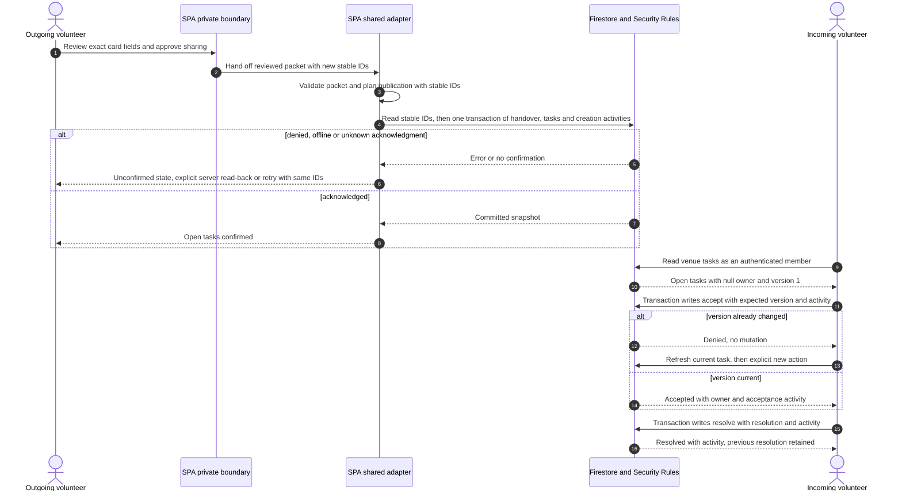

# ShiftRelay — architecture

Status: Phase 4 contract, extended by the Rules/persistence cut, the manual slice 1 UI cut, the
strictly local drafting slice 2 cut and the consented cloud reconciliation slice 3 cut (November
16–17, 2026). Owner: implementer. `firestore.rules`, emulator configuration, the transaction adapter,
the Auth emulator session, the responsive manual UI, the on-device draft adapter and the
`ONLY_IN_CLOUD` reconciliation adapter now exist and were measured against the local
`demo-shiftrelay` Auth and Firestore emulators plus one real Chrome localhost `ON_DEVICE` request;
no live project, cloud request or deployment exists. Scope of this cut: boundaries, frozen contract,
one sequence diagram, the designed Rules and request/read budget, the measured Rules results, the
manual private-draft → review → publication → accept/resolve/reopen workflow, the `ONLY_ON_DEVICE`
local draft path, and the separately consented reconciliation packet/consent/observation contract.
No live cloud AI call, App Check enforcement or Hosting. The domain contract did not change; the local
draft contract is frozen in `docs/INTERFACES.md` §9 and the reconciliation contract in §10.

Read with `docs/spec.md` (requirements), `docs/INTERFACES.md` (the frozen contract), `CONSTRAINTS.md`
and `docs/adr/0001-shiftrelay-stack.md`. Spec text wins over this file; where this file refines a
word like "atomic", the refinement is listed in §8 as a residual risk, not presented as a weaker
requirement.

## 1. System context (C4 level 1)

Two provisioned volunteers close one non-emergency handover at one venue. There is no public
signup, no server component, and no private-note collection.

| Element | Kind | Responsibility | Trust position |
|---|---|---|---|
| Outgoing volunteer | Person, authenticated, role `outgoing` | Captures a private note, reviews cards, approves publication | Trusted to act for the venue; untrusted input |
| Incoming volunteer | Person, authenticated, role `incoming` | Reviews shared tasks, accepts, resolves, reopens, confirms observations | Trusted to act for the venue; untrusted input |
| Venue administrator | Person, out of band | Provisions `members/{uid}` with a role; never through the app | Not implemented; no client write path exists |
| ShiftRelay web app | Software system (this repository) | Private draft, review, publication, ownership workflow, reconciliation consent | Runs on an untrusted client device |
| Firebase Authentication | External system | Identity of both volunteers | Authority for `request.auth.uid` |
| Cloud Firestore + Security Rules | External system | Shared records, transactional state changes, authorization | Authority for shared truth and permissions |
| Firebase AI Logic (local model) | External system | Optional on-device drafting in the page | Returns untrusted suggestions |
| Firebase AI Logic (cloud model) | External system | Optional, separately consented reconciliation | Returns untrusted suggestions |
| App Check | External system | Attestation for AI Logic and Firestore before public release | Abuse control, not identity |

Data crossing into the shared system is limited to the reviewed allowlisted packet. A private note,
raw source spans and unapproved model output never leave page memory; the boundary is described in
§3 and enforced by the absence of any private collection, storage write, URL parameter or telemetry.

## 2. Container view (C4 level 2)

| Container | Technology (planned) | Responsibility | Depends on |
|---|---|---|---|
| Private draft surface | React component state in page memory | Raw note, manual cards, editable review | Nothing shared; no storage or network |
| Shared handover surface | React component state + Firestore modular SDK | Publication preview, task list, accept/resolve/reopen, pending/conflict states | Auth session, Firestore, Rules |
| Domain contract module (`src/domain.ts`, `src/validation.ts`) | Strict TypeScript, no SDK import | Frozen types, limits, packet/task/activity validation, transition planning | Nothing (pure) |
| Local inference adapter (`src/localDraft.ts`) | `firebase/ai` with `ONLY_ON_DEVICE` | Single-turn extraction from the private note | Browser capability, explicit user action |
| Cloud reconciliation adapter (`src/reconciliation.ts`, `src/cloudReconcile.ts`, `src/CloudReconciliation.tsx`) | Pure contract + `firebase/ai` with `ONLY_IN_CLOUD` (`gemini-3.5-flash-lite`) | Bounded duplicate/contradiction suggestions from an approved shared-task packet | Published task snapshots, one-shot consent |
| Identity session | `firebase/auth` with in-memory persistence | Email/password sign-in, UID, membership-derived role, revocation handling | Auth emulator, Firestore membership |
| Runtime configuration gate (`src/runtimeConfig.ts`, `src/firebase.ts`) | Pure resolver + modular `firebase/app`, `firebase/app-check` | Selects exactly one of `emulator` / `live-local` / `hostedQA`, validates project/app/host and initializes App Check before any AI request | Origin, build-time public site key, dev runner environment or same-origin Hosting config |
| Shared store | Cloud Firestore Standard edition + memory cache | Handovers, tasks, activities, memberships | Security Rules |

Deliberately absent: application server, Cloud Functions, Cloud Run, private collection,
persistent local storage, offline write queue, service worker, telemetry. Each would either widen
the private-data surface or move authorization somewhere this scope does not fund.

## 3. Trust boundaries and where each guarantee lives

| Boundary | Enforced by | Not enforced by |
|---|---|---|
| Shape, type, byte caps, extra keys, unpaired surrogates | `validateReviewedPacket` / `applyTransition` (pure, tested) | Firestore, UI hints |
| Shared-field byte caps, immutable published content, allowed field changes, actor binding, server time | Security Rules (`toUtf8().size()`, `request.auth.uid`, `request.time`) in `firestore.rules`, measured in the emulator | Client validation alone |
| Atomic publication, task + activity coupling, no standalone activity | One Firestore transaction plus Rules post-write checks (`getAfter`), measured for 1–5 cards | Sequential client writes |
| No double ownership under a race | Client transaction read set + Rules version precondition, measured | Rules alone (see §8, R2) |
| No silent offline replay | `runTransaction` (rejects offline) + stable IDs + explicit server read-back; the adapter never calls `disableNetwork` or `writeBatch` | A queued `writeBatch` or an explicit Firestore offline buffer |
| Private note never persisted | Page-memory-only design; no private collection; Auth in memory, Firestore memory cache | Any client-side redaction claim |
| Role is membership, not a toggle | Membership document read at sign-in and watched for revocation; no role control in the UI | UI role switch |
| Human confirmation of observations | UI review step plus one versioned activity per confirmation | Model output |
| Cloud packet contents and one-shot consent | Pure `planReconciliation` allowlist, byte-equal preview/consent, fresh-read version checks, operation token | Model output, UI hints, "read-only" promises |
| Exactly one runtime mode, fail-closed | `resolveRuntimeConfig` (pure, tested) plus `vite.config.ts` build refusal, `scripts/dev_live_local.py` allowlist, `scripts/check_dist.py` build-output guard | A missing or wrong value silently degrading to another mode |
| Live requests are attested | `initializeAppCheck` runs while `src/firebase.ts` is imported, before any AI call; production uses reCAPTCHA Enterprise, localhost uses the registered debug token | Client-side checks, "it is enforced by default" claims |

Timestamps are intentionally absent from the pure domain type (`Task` has no `createdAt`/`updatedAt`,
`ActivityRecord` has no `at`): the persistence boundary supplies `request.time`, and a pure function
cannot honestly invent server time. `INTERFACES.md` lists the persisted fields.

## 4. Interaction sequence

One diagram only, as the two-diagram budget requires (§7). It shows the publication and ownership
path that this phase's contract covers; strict local drafting is implemented in `src/localDraft.ts`
and frozen in `docs/INTERFACES.md` §9, and consented reconciliation is implemented in
`src/reconciliation.ts`/`src/CloudReconciliation.tsx` and frozen in §10. Neither AI path is modelled
here.

## 5. Invariants and their owner

| Invariant | Owner | This phase's evidence |
|---|---|---|
| 1–5 cards, exact keys, byte caps, no unpaired surrogates, no normalization | `src/validation.ts` | `tests/validation.test.ts` (green) |
| Published task content immutable, state/owner/version/resolution only via a listed transition | `firestore.rules` + `applyTransition` | `tests/transitions.test.ts` and `tests/rules/permissions.test.ts` (green) |
| `version + 1` on every change, one activity per version with a derived ID | Rules + `applyTransition` | both suites (green) |
| Actor bound to `request.auth.uid`, time to `request.time` | Rules | `tests/rules/permissions.test.ts` (green) |
| Publication and activities commit together | One transaction + `getAfter` in Rules | 1–5 card publication and partial-batch denials (green); stable-ID read-back and ID conflict (green) |
| An uncertain or offline action is never confirmed or silently replayed | Adapter transaction semantics + UI pending/unconfirmed state | Playwright offline suite (green), lost-ack read-back in Rules suite (green) |
| Only `incoming` accepts; only the owner resolves or reopens; `outgoing` cannot self-assign | `firestore.rules` now, `applyTransition` as the client guard | both suites (green) |
| Observation never mutates the target | Rules + `applyTransition` | `tests/rules/permissions.test.ts`, `concurrency.test.ts` (green) |
| Cloud packet is the exact approved allowlist, and consent is one-shot | `src/reconciliation.ts` + UI operation token | `tests/reconciliation.test.ts` and `e2e/reconciliation.spec.ts` (green, labelled mock) |
| Private text never persisted | Architecture (no collection, memory cache) + UI memory-only state | `e2e/privacy.spec.ts` sentinel checks (green) |
| Role and revocation come from membership | Auth UID + membership read/watch | `e2e/privacy.spec.ts` revocation (green) |

## 6. Firestore Security Rules request and read limits

Current documented limits (Context7 `/websites/firebase_google`, retrieved November 16, 2026, from
the Rules limits table in `security/rules-structure` and `security/rules-conditions`): at most
**10** `exists()`, `get()` and `getAfter()` calls for a single-document or query request, at most
**20** for a transaction or batched write, with the 10 limit still applying to each operation
inside it; cached document access calls do not count. Rules are not filters, so every list query
must be bounded and venue-scoped; `firestore.rules` denies a list without a limit or with a limit
above 50.

Authored cost model (`firestore.rules`):

- Membership: one `get()` per `isMember`; `isOutgoing`/`isIncoming` read the same path once more,
  which the documented caching collapses onto the same call.
- Handover create: membership (2) plus one `getAfter` per task id (1–5), because the handover must
  prove every listed task exists in the same batch: 7 at five cards.
- Task create: membership (2) plus `getAfter(handover)` and `getAfter(activity)`: 4.
- Task update: membership (1) plus `getAfter(activity)`, plus the observation target `getAfter()`
  when the action is `observe`: 2–3.
- Activity create: membership (1) plus `getAfter(task)`: 2.

| Cards | Writes (`2N+1`) | Distinct document paths (`2N+2`) | Calls if nothing is cached (`7N+2`) | Calls per write (max 10) |
|---|---|---|---|---|
| 1 | 3 | 4 | 9 | 4 |
| 3 | 7 | 8 | 23 | 5 |
| 5 | 11 | 12 | **37** | 7 |

Reading of that table:

- Per-operation cost is at most 7 calls, far under 10, so no individual write is at risk.
- The atomic budget of 20 is met at five cards **only if repeated `get()` calls on the same path
  within one batched write are cached**, as the documentation allows ("some document access calls
  may be cached"). The distinct-path count is 12 at five cards, and the 20 limit is a call budget,
  not a path budget.
- Measured: the emulator (cloud-firestore-emulator 1.22.0) **accepted** the five-card publication
  batch, and every smaller size, with tasks and creation activities committed together. The
  emulator does not report whether it enforces the 10/20 call limits, so this is functional
  evidence, not production-budget proof. The card cap is a spec requirement and was not lowered;
  if a production ruleset ever denies a five-card batch, the case goes to master (see §8, R3).

Observations cost 2 writes (source task update, activity create) and 5 uncached calls: membership
plus `getAfter(source activity)` plus `getAfter(target)` on the task update, and membership plus
`getAfter(source task)` on the activity create. That is 4 distinct paths, comfortably inside 20.
Their risk is not the call budget but the target snapshot (§8, R1).

No constraint from `docs/spec.md` was found infeasible. Three conditions are recorded rather than
silently assumed: R1 (target snapshot), R2 (race uniqueness is a transaction property) and R3
(production call budget at five cards).

## 7. Diagram budget reconciliation

`phases/4-5-build.md` asks Cortes 1 for `C4Context`/`C4Container` **and** a `sequenceDiagram`.
`workflow/core.md` §0.4/§1.6 allows **2 diagrams in `full`**: one flow and one architecture, one in
`lite`. Literal compliance with both would need three diagrams in one document and exceed the
budget the same workflow declares blocking.

Resolution recorded here and in `docs/verification.md`:

- C4 boundaries are expressed as the two text tables in §1 and §2 with explicit trust positions
  instead of C4 diagrams. C4 is a modelling convention; nothing in the spec requires rendered C4.
- The single architecture diagram is the sequence in §4, because the interaction across the private
  boundary, the transaction and Rules is the part that a reader cannot infer from prose.
- Budget: `docs/spec.md` flowchart (1) + `docs/ARCHITECTURE.md` sequence (1) = 2. No further
  diagrams are added for interfaces, data model or state machine. Both render in Gate A/D checks
  through `scripts/check_diagrams.py`.

## 8. Residual risks and infeasible-by-Rules-only constraints

**R1 — Observation target versions are validated, not locked.** Rules `getAfter()` reads the
post-state, so an observation cannot cite a target version that the same batch resolves or accepts,
and a target that moved in an earlier commit is rejected at evaluation. It still creates no write
precondition on a document the batch does not write, so a target changed by a separate concurrent
commit between evaluation and commit is not locked; the client transaction must also read the target
so that such a change aborts the transaction. Measured: a target that moved to version 2 rejects an
observation recorded against version 1, both through the transaction adapter (client read set) and
through a forged direct write (Rules); a batch that resolves the target and observes its earlier
version is denied as a whole, while an unchanged target records normally. Consequence: the recorded
target version is operational metadata, not a certified audit fact — consistent with the spec's own
statement that activity is "a useful operational record, not a certified tamper-proof audit system".
No stronger claim is made.

**R2 — "Exactly one accept" is a transaction property.** Rules enforce `open` → `accepted`,
`ownerId === request.auth.uid` and `version === resource.data.version + 1`, which rejects a losing
accept that reuses a stale version. Uniqueness under a true race is still delivered by the Firestore
transaction read-set conflict, so the design must use `runTransaction`, never a blind write. Measured:
two isolated clients racing one open task produced exactly one owner, one version-2 acceptance event
and no second event; the loser failed. Rules alone cannot enumerate "exactly one event" across two
clients.

**R3 — Five-card atomic publication depends on documented call caching.** Measured: the emulator
accepted 1–5 card batches atomically, and partial, over-linked and six-card batches were denied. The
emulator does not expose whether it enforces the 10/20 call limits, so the production budget (§6)
remains a documented-risk item rather than a production measurement. The cap stays at five; a
production denial escalates to master instead of lowering the cap.

**R4 — Client/Rules byte equivalence (measured for this emulator).** The client counts UTF-8 bytes
with `TextEncoder` and rejects unpaired surrogates; Rules use `value.toUtf8().size()`. Measured in
the emulator: for ASCII, supplementary `U+1F600`, combining `e` + `U+0301`, precomposed `U+00E9` and a
mixed string, the client verdict and the direct-Rules verdict agree at the title cap (120) and one
byte over, at the detail cap (800) and one byte over, and accepted strings read back byte-identically
with no normalization. Resolution (800) and reopen reason (400) caps are enforced by Rules with the
same byte measure. This is emulator evidence for those fixtures, not a proof over every possible
string, and it says nothing about the unmeasured live project.

**R5 — Scope of the evidence.** Rules, publication and transition transactions, the Auth
emulator session and the manual UI are measured only against local emulators with synthetic
identities. The privacy/accessibility suites are automated browser checks, not a device or WCAG
certification. The local model, cloud reconciliation, App Check, Hosting, lint/build evidence for a
live deployment and any live Firebase behavior remain unmeasured.

**R6 — Missing coupled records deny through an evaluation error.** In this emulator version
(1.22.0), `exists()`/`existsAfter()` and negated null comparisons themselves raise evaluation errors,
so `firestore.rules` accesses coupled documents directly: a missing membership, handover, task or
activity makes the rule error, and a Rules evaluation error denies the request. That is fail-closed
and every missing-record case is asserted as a denial in the suites, but it means a denial caused by
a missing record is not distinguishable from a policy false in emulator logs. Production Rules
document the same fail-closed behavior for document access; no rule relies on an error being treated
as allow.

**R7 — Offline semantics were measured in a real browser, not by `disableNetwork`.** The Firestore
`disableNetwork()` API intentionally queues writes and transactions until reconnection, so it cannot
prove the no-replay requirement and is never called by the app. Real browser offline
(`BrowserContext.setOffline`) was tested: publication, accept and resolve stayed unconfirmed, the
emulator held no document, and an explicit retry after reconnection wrote exactly once. This is
emulator/browser evidence, not a production network-partition proof. The transaction is still the
chosen operation; a switch back to `writeBatch` would reintroduce the replay risk recorded in the
contract.

**R8 — Runtime mode guard.** `src/runtimeConfig.ts` resolves exactly one mode and throws a named
`RuntimeConfigError` otherwise: `emulator` only for `demo-shiftrelay` on `127.0.0.1`/`localhost`,
`live-local` only on a local host with the dev runner's flag and every allowlisted live value present
and matching the approved project/app, `hostedQA` only on the two approved Hosting origins and only
after a same-origin config read that names the same project and web app. There is no fallback between
modes and no "unknown origin" path. The remaining limits: the Hosting reserved JSON endpoint's support
for the modular SDK is unproven upstream (reserved URLs are documented for JS SDK 8 and earlier, and
`master`'s read of an undeployed site returned 404), so `hostedQA` needs an empirical check after the
gated deployment; and the mode decision trusts the browser's own origin value, which is the same trust
the existing local guard already had.

**R9 — Cloud reconciliation: one live request measured on localhost, not a live product.** The pure
contract, the `ONLY_IN_CLOUD` adapter with the explicit free-tier model `gemini-3.5-flash-lite`, and
the one-shot consent/observation flow are measured with unit and emulator/browser tests, and one
genuine consented request now ran from `live-local` on localhost with the registered debug token
(`exchangeDebugToken` 200, `firebasevertexai .../gemini-3.5-flash-lite:generateContent` 200). What is
still open: a request from a hosted HTTPS build with reCAPTCHA Enterprise attestation, in-app cloud
comparison (blocked until the reviewed Rules are deployed, because the membership read is denied by
the current closed posture), quota/latency beyond one call, and App Check *enforcement* — a second
request from an app instance with no App Check initialization was accepted (200), so no rejection was
observed and the product must not claim enforcement evidence. Every suite result still comes from a
page-injected `test-network-mock` double, which development builds only ever reach, never a
production bundle. The fresh server read before and after the request narrows, but cannot eliminate,
the window in which another client changes a task between the approved packet and the result.

**R9 dated note — November 19, 2026.** The App Check *enforcement* limit above is superseded as
evidence, not rewritten: the service policy for `firebaseml.googleapis.com` was absent when the
earlier run was captured, and it was later set to `ENFORCED` and probe-proven through the AI Logic
proxy (valid token `200`, missing and garbage token `401`) in
`docs/adr/0007-appcheck-enforcement.md`. The earlier observation stays as the record of that run.
Still open from R9: a hosted HTTPS request with reCAPTCHA Enterprise attestation, in-app cloud
comparison, and quota/latency beyond one call.

## 9. What is not built

Historical as of the November 17, 2026 cut. Explicitly out of this cut, so no reader mistakes the
contract for a product: a hosted HTTPS build, Hosting configuration and deployment, App Check
*enforcement* evidence, an in-app live cloud comparison (blocked by the undeployed Rules),
quota/latency beyond one measured call, and the manual screen-reader/200%-zoom/Android-touch checks.
The manual private-to-shared UI, Auth emulator session, Playwright suites, lint, production build,
the strictly local `ONLY_ON_DEVICE` draft path, the consented reconciliation contract/flow, the three
runtime modes and one genuine consented `ONLY_IN_CLOUD` request from localhost exist and are
measured. Exact Nano 4 identity is unverified, and `docs/PLAN.md` lists the owning slice for the
rest.

**Dated note — November 19, 2026.** Two statements above are superseded as current status while the
list stays as the cut it describes: App Check enforcement is now `ENFORCED` and probe-proven
(`docs/adr/0007-appcheck-enforcement.md`), and the local Nano 4 path is proven on localhost
(sponsor-documented Gemma 4 flag, `gemma4_component`, genuine `ONLY_ON_DEVICE` generation;
`docs/adr/0006-nano4-runtime-proof.md`). Hosting, the hosted reCAPTCHA-attested requests, the
in-app cloud comparison, Firestore App Check enforcement and the manual accessibility checks are
still not built or not measured.
