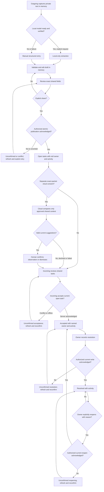

# ShiftRelay — Workflow specification

Status: proposed framing, November 16, 2026. User selected ShiftRelay and requested continued planning; implementation remains unauthorized. Gate A is **pending**, not passed. Skills applied to this artifact: brainstorming, spec-driven-development, mermaid-diagrams. Phase workflow overrides skill defaults about interviews, extra spec files, and stopping before the delegated plan.

## Objective, users, and assumptions

Close a non-emergency handover at **one community venue**: an outgoing volunteer turns private text into reviewed shared tasks; an incoming volunteer explicitly accepts responsibility, records resolution, and can reopen unfinished work. Success is recorded ownership and closure, not a polished summary.

Declared defaults, not user-research findings: one venue; two pre-provisioned authenticated demonstration participants; text only; synthetic data; no public signup; outgoing/incoming are provisioned venue roles, not a client-side view switch. The user can review these defaults through master. Android delivery means responsive web with manual capture and optional consented cloud reconciliation. A future native client is not promised. No device-local Android-browser claim.

Outcome hypothesis: each of two representative coordinators can identify a recurring handover failure this closes; an incoming participant can accept three seeded items within 120 seconds. These are validation targets, not measured results. Product validation does not substitute for technical/privacy checks.

## Scope and boundaries

**Must:** private memory-only capture; manual entry; strictly local extraction when verified available; editable review; explicit sharing; separate optional cloud consent; source-linked reconciliation proposals; server-enforced permissions; accept/resolve/reopen; append-only activity; visible pending/conflict/error states; accessible desktop/mobile web; real Firebase AI Logic + App Check evidence before any hybrid submission claim.

**Not now:** multiple venues, rosters/scheduling, chat, notifications, uploads/OCR/voice, emergency operations, worker scoring, automatic assignment, automatic AI writes, public membership administration, offline sync/ownership, PWA/service worker, native Android, destructive task merging, telemetry/analytics, or external integrations. Reconciliation marks a human-confirmed related/duplicate observation; it does **not** collapse records or silently close a duplicate. If necessary, its owner resolves it explicitly with a duplicate explanation.

Always validate untrusted fields and fail closed. Ask master before schema/scope changes, new dependencies, infrastructure, or spending. Never upload private notes, install skills/dependencies, provision services, or start implementation under this brief. No platform API syntax is introduced here; existing stack sources are in ADR 0001. Master must use Context7 for current APIs at implementation time.

## Stack and planned boundaries

React + strict TypeScript + Vite static SPA; modular Firebase JS SDK for AI Logic, App Check, Auth, Firestore; classic Firebase Hosting. Vitest for domain/validation, Playwright for UI, Auth/Firestore emulators for authorization. Exact mutually compatible versions and lockfile follow authorization and compatibility checks, not this document. No application or commands currently exist.

| Boundary | Responsibility | Depends on |
|---|---|---|
| private-draft | Memory-only raw note, local extraction, runtime validation, manual editor and preview | Local capability probe; no shared persistence |
| shared-handover | Session/membership, reviewed publication, task transactions, Rules and activity | Validated allowlisted reviewed packet |
| reconciliation | Optional approved shared-context comparison and ephemeral suggestions | Authorized shared records and exact-version consent |

This is one end-to-end capability, not three independent products. Build order is manual private-to-shared loop → genuine local drafting → optional cloud reconciliation. Boundaries are a contract sketch; Phase 4 owns `docs/INTERFACES.md` and `docs/ARCHITECTURE.md` without adding scope.

## Data and consent contract

All counts/lengths are proposed product limits, checked independently at boundaries. **Every text-length limit below means UTF-8 encoded bytes of the exact string**, not JavaScript `.length`, Rules `String.size()`, Unicode code points or grapheme clusters. Keep the numeric caps unchanged; the byte contract is deliberately stricter for non-ASCII text than the superseded UTF-16 assumption. Client validation counts UTF-8 bytes; Rules enforce shared-field limits with `value.toUtf8().size()`. Required fields must also be nonblank. Preserve the exact reviewed string: no implicit Unicode normalization, truncation or encoding repair; reject unpaired UTF-16 surrogates in client/model input before encoding. UI limits/errors must say bytes rather than imply a visible-character count. No rich text rendering.

**Official basis (Context7 `/websites/firebase_google`, November 16, 2026):** [Rules String reference](https://firebase.google.com/docs/reference/rules/rules.String) describes `size()` only as the “number of characters”; the retrieved definition does not specify UTF-16/code-point/grapheme semantics. It explicitly defines `toUtf8()` as UTF-8 byte encoding. [Rules Bytes reference](https://firebase.google.com/docs/reference/rules/rules.Bytes) defines `size()` as the number of bytes. These support an explicit byte contract, **not** a claim that Rules string length equals JavaScript string length. Cross-boundary conformance still requires emulator tests; documentation is not runtime evidence.

**Shared conformance fixtures (AC02):** for a 120-byte title cap, 120 ASCII `a` pass and 121 fail; 30 `U+1F600` supplementary characters occupy 120 bytes and pass, 31 occupy 124 and fail; 40 repetitions of `e` + `U+0301` occupy 120 bytes and pass, 41 occupy 123 and fail; 60 precomposed `U+00E9` occupy 120 bytes and pass, 61 occupy 122 and fail. A single `U+00E9` is 2 bytes, while `e` + `U+0301` is 3: visually similar text is not normalized to equal size. Repeat mixed ASCII/supplementary/combining cases exactly at and one byte above each persisted field's cap using ASCII padding, through both client validation and direct emulator writes. They must agree on allow/deny and preserve accepted strings exactly on read-back. Source spans are separate private-only offsets into the unchanged raw note, expressed as UTF-16 start-inclusive/end-exclusive indices; they must not split surrogate pairs and are never interpreted by Rules as text lengths.

| Record | Fields and limits | Location/authority |
|---|---|---|
| Private session | Raw note 1–4,000 UTF-8 bytes; up to 5 draft cards; raw source spans and unapproved model response | Page memory only; clear on discard/sign-out; reload/close can lose work, warned before capture |
| Reviewed task input | Title 1–120; detail 0–800; no owner/state/actor fields supplied by AI; 1–5 cards per publication | New allowlisted object shown in preview; no serialized session/editor objects |
| Handover | ID, fixed venue ID, creator UID, server time, 1–5 created task IDs | Shared immutable publication record, atomic with tasks and creation activities |
| Task | ID, venue ID, handover ID, creator UID, created time, title, detail; state `open`, `accepted`, or `resolved`; owner UID or null; integer version starting at 1; updated time; resolution text 1–800 only when resolved | Shared; creation metadata/content immutable after publication; only authorized transitions change state/owner/resolution/version/time |
| Activity | ID deterministically derived from task ID and resulting version; task/venue IDs, actor UID, server time, from/to states and versions, action; resolution or reconciliation fields only for that action | Shared, append-only; exactly one event per task version, created atomically with that change |
| Membership | UID, venue, role `outgoing` or `incoming` | Administrator provisioned; no client writes; session-scoped Auth, no persistent Firestore disk cache |
| Reconciliation request | Exact preview of shared task IDs, versions, titles, details, states and resolution-free open/accepted context, plus instruction text; at most 5 just-published tasks plus 20 other open/accepted tasks | Memory-only request assembled from fresh authorized reads; no raw notes, private source spans, membership roster, or activity payloads |
| Reconciliation response | Up to 5 suggestions: kind `duplicate` or `contradiction`, two distinct request task IDs and versions, rationale 1–400; brief 0–1,200 | Memory-only, runtime validated; no unknown keys, unknown IDs, commands, owners, or persistence unless human confirms a suggestion |

The cloud context limit requires a visible selection/preview when more than 20 other tasks exist; never claim exhaustive comparison. Local output uses at most 5 title/detail cards with valid source spans into the raw note; unknown facts must be omitted or presented for manual correction, never invented as authoritative task fields. Over-limit input is rejected visibly, not silently truncated. Empty/whitespace-only required fields fail validation. Unknown keys, invalid types, malformed JSON, oversized responses, invalid spans, injection text and model HTML are untrusted; display plain text or reject, never execute. Cap accepted model response text at 12,000 UTF-8 bytes before structured validation.

**Sharing:** every edit invalidates the reviewed snapshot. A dedicated Share action approves only the visible card fields for venue persistence. Sharing does not grant cloud consent. Publication uses stable IDs for retry; after an uncertain acknowledgment, read those IDs before offering retry so a successful prior publication cannot duplicate tasks. No silent background retry or queued offline write.

**Cloud:** only after successful sharing, a separate action previews the exact outbound packet, recipient purpose, included task versions and system instruction. Consent is one-shot for that packet/request; edits, changed context/version, sign-out or canceled request invalidate it. Re-read versions before sending; any difference requires a new preview and consent. Decline/cancel sends nothing and leaves manual ownership usable. Discard late responses after cancellation, context changes or session changes. A cloud request already sent cannot be recalled; explain this before consent. A failure requires another explicit user retry/consent, not silent resubmission.

Private data never enters Firestore, browser storage, URL parameters, console/error logs, analytics, crash reports, or cloud prompts. Clear memory and screen on sign-out, session loss, or member-access loss; ignore late results. Model-download/auth/attestation metadata is not proof of note transmission or proof of whole-device secrecy. No promise against extensions, compromised devices, or private content a human explicitly copies into approved shared fields; review/redaction is not guaranteed anonymization.

## Permissions and deterministic transitions

Rules deny by default. Signed-out users and nonmembers cannot read/write venue records or memberships. A member can read own membership and the venue's shared records, not enumerate the membership roster. Both roles may draft privately, view shared records, and request cloud comparison of those records; only **outgoing** may publish. Only **incoming** may accept. Neither role can grant membership, change venue/creator/content, delete shared records, or edit/delete activities. No UI restriction substitutes for Rules; private model data does not have a collection.

| Action | Actor and precondition | Atomic postcondition |
|---|---|---|
| Share | Outgoing; exact reviewed packet valid; new publication/task IDs | Handover and tasks created together; each task `open`, owner null, version 1, creation activity |
| Accept | Incoming; task `open`, owner null; expected version matches | `accepted`, owner = authenticated actor, version +1, acceptance activity |
| Resolve | Incoming owner; task `accepted`; expected version matches; nonblank resolution 1–800 | `resolved`, owner retained, version +1, resolution + activity |
| Reopen | Incoming owner; task `resolved`; expected version matches; nonblank reason 1–400 | `accepted`, same owner, current resolution cleared (old resolution remains in activity), version +1, reopen activity |
| Confirm observation | Either member role; two distinct still-current open/accepted tasks; validated suggestion or manually reviewed observation | Source task state/owner unchanged, version +1; activity records kind, target ID/version, rationale. Read and validate target version atomically; no target mutation |

All other transitions fail without mutation: self-assignment by outgoing, accepting accepted/resolved tasks, resolving open tasks, reopening another owner's task, owner replacement/release, arbitrary state patches and forged version jumps. Unassigned is explicit via null owner, never an AI guess. Two simultaneous accepts yield exactly one owner/event. Every task change increments by exactly 1 and requires its matching activity; Rules bind actor to auth UID and time to server request time, constrain exact field changes, validate matching task/event post-state, and reject standalone events. Creation also checks handover/task/event linkage. Reconciliation confirmation requires both referenced versions still match; stale suggestions do not grant authority.

Use server-acknowledged transactions, with expected versions captured when the user acts. Retried callbacks recheck those expectations, never replay an AI call or consent prompt. A stale/conflicting operation does not silently rebase: show Conflict, refresh, and require a new action. Render pending immediately but never label an operation shared/accepted/resolved/confirmed until acknowledgment. On offline/permission/timeout errors retain applicable unsent memory input, mark unconfirmed, and offer explicit retry after refresh; when delivery is uncertain, reconcile from server first. No unacknowledged write appears as confirmed shared truth. Activity is a useful operational record, not a certified tamper-proof audit system.

## Failure and edge behavior

- Unsupported/downloading/unavailable local model: show distinct state and manual entry; model initialization/download needs explicit user action. Local errors keep the raw note only in memory; no cloud fallback. Model success still requires review/share.
- Empty/refused/malformed/oversized/injected AI output: reject or show a non-actionable error, preserve manual work and shared state; no auto-writes or new inferred owners. Validate factual content manually even when schema passes.
- Cloud denied, offline, quota failure or timeout: no state mutation; accept/resolve remains independent when online; explain inability to reconcile. At most one in-flight request; no automatic retries.
- Rapid double-click, concurrent update or lost acknowledgment: stable operation IDs/version checks, disabled duplicate submission, conflict/read-back instead of duplicate events. A late response cannot restore cleared private data.
- Lost authentication/membership: deny further reads/writes, clear visible private/shared session state, show reauthentication/access error without sensitive payloads. No list query that assumes Rules are a client-side filter.
- Keyboard/touch: semantic inputs, labels, visible focus, understandable errors/status announcements; preview and consent can be canceled and focus returns to the trigger. No hover-only action; long titles wrap. Narrow layout and zoom do not hide ownership/confirmation controls.

## Acceptance criteria and planned proof

**All tests/commands below are future contracts, not executed or currently available.** Implementer creates the named files/scripts. `npm run test:unit -- <path>` runs Vitest once; `npm run test:rules -- <path>` runs the selected tests against Auth/Firestore emulators; `npm run test:e2e -- <path>` runs Playwright against an emulator-backed app. Mocks are labeled and never counted as real hybrid evidence. Package scripts must be documented with exact installed CLI mappings before use.

| ID | Acceptance criterion | Concrete planned test/command and assertions |
|---|---|---|
| AC01 | Outgoing manually captures, reviews and shares 3 cards; incoming sees only approved content | `npm run test:e2e -- e2e/handover.spec.ts`: two isolated authenticated sessions; edit preview then share; exactly 3 open/unassigned tasks and 3 creation events, no raw note |
| AC02 | Exact bounded allowlisted records and immutable published content | `npm run test:unit -- tests/validation.test.ts` and `npm run test:rules -- tests/rules/permissions.test.ts`: UTF-8 byte-boundary conformance fixtures above (ASCII, supplementary, combining, precomposed and mixed strings) yield identical client/direct-Rules allow/deny and exact accepted read-back; client rejects unpaired surrogates; counts, whitespace, unknown keys/types, forged fields, mutation of content, handover linkage failures rejected |
| AC03 | Local-only extraction never shares or persists automatically; unavailable/downloading/error states allow manual work | `npm run test:e2e -- e2e/local-draft.spec.ts`: injected capability states and local success/error, note retained, zero sharing/cloud calls; real local path separately required by AC13 |
| AC04 | Bad AI output cannot change task state or execute markup | `npm run test:unit -- tests/ai-output.test.ts` plus `npm run test:e2e -- e2e/reconciliation.spec.ts`: empty/refusal/invalid JSON, unknown IDs/versions, invalid or surrogate-splitting spans, extra keys, >12,000 UTF-8 bytes including supplementary/combining fixtures, HTML/instructions rejected or plain text; zero writes |
| AC05 | Private sentinel never leaks; approved preview exactly equals outbound fields | `npm run test:e2e -- e2e/privacy.spec.ts`: unique sentinel in raw notes, remove it from reviewed cards; inspect request bodies, storage, Firestore writes, URL and console/error captures for success/download/failure, declined consent, edits, navigation and sign-out; zero sentinel matches. Assert requests equal preview and late output cannot repopulate cleared session. Real-device repeat under AC13 |
| AC06 | Cloud approval is separate, exact-version, one-shot and optional | `npm run test:e2e -- e2e/reconciliation.spec.ts`: share without cloud; decline/cancel; edit/change context invalidates approval; retry needs new approval; stale/late result discarded; only expected approved request sent; accept remains possible without AI |
| AC07 | Only permitted identities/transitions work even through direct SDK access | `npm run test:rules -- tests/rules/permissions.test.ts`: signed-out/nonmember/cross-venue reads and writes, roster reads, role escalation, outgoing accept, nonowner resolve/reopen, delete, forged actor/time, standalone/omitted/edited activities all denied; positive cases for every transition |
| AC08 | Valid owner explicitly resolves and reopens with intact history | `npm run test:unit -- tests/transitions.test.ts` and `npm run test:e2e -- e2e/handover.spec.ts`: open → accepted → resolved → accepted, exact version +1 each time, retained owner, prior resolution in history, required reason and visible pending/confirmed states |
| AC09 | Stale writes and simultaneous accepts never overwrite ownership | `npm run test:rules -- tests/rules/concurrency.test.ts`: two isolated clients race; exactly one accept/event; captured stale versions fail; stale observation targets fail. `npm run test:e2e -- e2e/conflicts.spec.ts`: loser sees conflict and must refresh/reconfirm |
| AC10 | Offline/failed/uncertain writes never claim success or replay on reconnection silently | `npm run test:e2e -- e2e/offline.spec.ts`: disconnect before share/accept/resolve, deny write, simulate lost acknowledgment; unconfirmed UI, no duplicate records on explicit retry/read-back, memory input preserved as applicable, no private upload or hidden queued write |
| AC11 | Reconciliation is bounded, source-linked and explicitly confirmed, not an automatic merge | `npm run test:unit -- tests/reconciliation.test.ts` and `npm run test:e2e -- e2e/reconciliation.spec.ts`: >20 context requires visible selection; duplicate projector fixture and contradictory status fixture reference valid IDs; confirmation appends one observation event, state/owner unchanged; dismiss writes nothing; source/target changes reject confirmation |
| AC12 | Full manual path works with keyboard and mobile layout | `npm run test:e2e -- e2e/accessibility.spec.ts`: keyboard-only capture/preview/share/accept/resolve/reopen, focus restoration, labels/errors/status, no horizontal document overflow at 320 CSS px. Manual check at 200% zoom plus screen-reader announcements and actual Android Chrome touch workflow; record browser/device, failures and ordinary-text contrast >=4.5:1. Automated accessibility scan has zero serious/critical findings |
| AC13 | Genuine required local model and cloud runtime work on the intended hosted platform | Manual reproducible protocol: on named desktop record OS/browser/SDK/hardware, enablement/download state, App Check enforcement, actual local request through Firebase AI Logic on localhost **and hosted HTTPS**, observed source and authoritative exact Nano 4 compatibility evidence; repeat privacy sentinel; separately consent and make real cloud comparison, recording model/source and payload allowlist without secrets. Zero mocks counted; manual unsupported-local path also demonstrated |
| AC14 | Build and public artifacts meet minimum safety/quality | `npm run typecheck`, `npm run lint`, `npm run build`, `npm audit --omit=dev --audit-level=high`, `npm run scan:secrets`, and future `py -3 scripts/verificar.py --report .git/opencode/evidence.json`: no type/lint/build errors, no high/critical production dependency findings, no credentials/debug secrets in source/build/evidence; reviewer inspects diff for weakened checks. Gate evidence format follows workflow |
| AC15 | Audience/usefulness hypothesis gets a go/no-go, not an invented success claim | Product lead runs two representative-coordinator walkthroughs on synthetic projector/supply fixtures; record recurring failure, missed/duplicate comparison with current approach, three-item acceptance time, correction errors, and whether cloud comparison changes a useful decision versus deterministic matching. Master records continue/cut/reframe decision; no useful cloud improvement means revisit hybrid fit, not decorative AI |

## Workflow source

Error nodes require a fresh server read and the relevant action's fresh confirmation; if current state no longer allows that action, show the current task instead. No error transition itself shares data. Source is retained in this file. No diagram render has been verified. Planner's earlier shell probe was permission-denied; this is historical and does not imply master shell access is blocked. Master subsequently reported shell verification of 15 criteria, 3 slices and 6 thresholds, with `mmdc` and `scripts/check_diagrams.py` absent. No installation is authorized. Gate A stays pending implementer-owned checker/render evidence, even if a separate preview later renders this Markdown.

## Owned questions and go/no-go checkpoints for master

These are questions to relay via **PREGUNTAS_AL_USUARIO**, not direct questions from planner. Named roles are accountable; master must assign people before execution. All default assumptions remain reversible; disclosure after a cloud request/publication cannot be recalled.

| Checkpoint / unresolved decision | Accountable role | Go evidence / no-go action |
|---|---|---|
| G0 — Permission to build, capacity, stack/default scope approval | Master + user/product owner | Explicit authorization and available effort; otherwise planning only. ADR approval wording remains pending, not silently changed here |
| G1 — Hardware and exact Nano 4 challenge compatibility | Master as eligibility owner + device-test implementer | Recheck official rules and obtain authoritative exact-model evidence plus successful genuine local request on available desktop; before local slice commitment. No device/model proof: do not claim compliant hybrid delivery; escalate to user to secure hardware or reconsider entry |
| G2 — Localhost versus hosted Prompt API enablement | Device-test implementer; master closes | Verify supported SDK/browser/origin configuration on both origins before hosted-local claim. Localhost-only success is no-go for hosted hybrid claim; do not silently substitute cloud |
| G3 — Firebase project, credentials, quota/budget and judge access | User/project administrator; master closes | Authorized project/API access, App Check setup/domains, synthetic identities/membership, selected cloud model, spending limit/monitoring and availability through December 16; before real calls/provisioning/public delivery. Unknown budget/access: emulator-only work if separately approved, no cloud-cost assumption; temporary sprint quota is not judging-window access |
| G4 — Android-native expectation | User/product owner through master | Confirm responsive web is sufficient before build scope approval. Native-required answer is no-go for this plan and requires rescoping/ADR/budget revision, not a wrapper promise |
| G5 — Representative users and useful reconciliation | Product lead, arranged by master | Two coordinator walkthroughs under AC15 before product-value/public impact claims; if unavailable mark unvalidated, if no recurring failure or useful cloud comparison reframe through master before final hybrid scope acceptance |
| G6 — Official Firebase agent skills | Master + authorized implementer | Before relevant build tasks: inspect current catalogs/upstream metadata, resolve actual names and pin reviewed revision/scope, obtain install approval, then install/load relevant skills. Not installed; names/revision unresolved despite ADR discovery candidates. No relevant Firebase build starts pretending they were adopted |
| G7 — Framing Gate A | Master, with planner artifacts | Verify docs/criteria/owned blockers and render using `py -3 scripts/check_diagrams.py`; checker implementation belongs to implementer later under separate authorization. Until real exit/output exists: pending, not approved |

## Current evidence limits

Read workflow/core, phase framing and gate instructions, AGENTS, project/budget, idea, stack ADR, preserved summary and handoff. Existing ADR technical sources are reused; the focused Unicode correction additionally queried official Rules String/Bytes references through Context7 as cited above. No SDK, runtime, user, accessibility, emulator, Rules, build, privacy or hosted test has run. No production code, scripts, scaffolding, installs, commits, pushes or provisioning were performed. The plan and constraints define future proof, not passing results.
